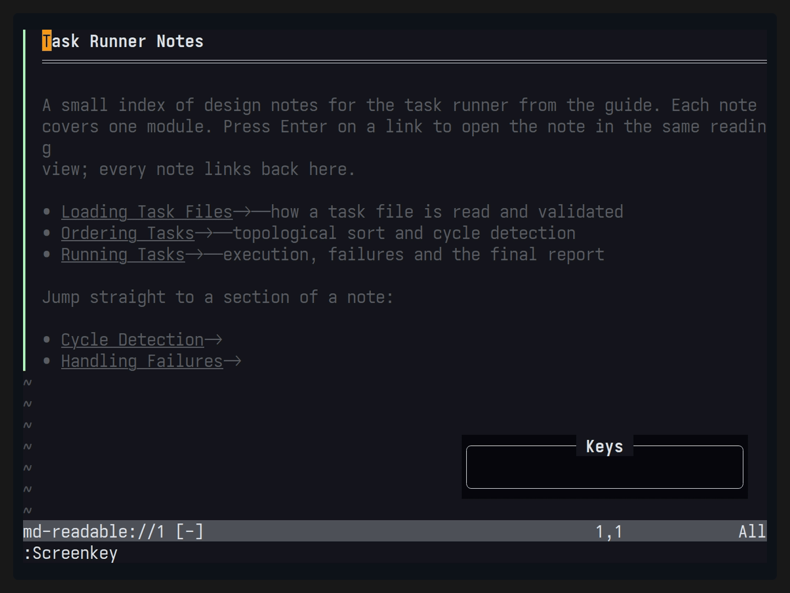
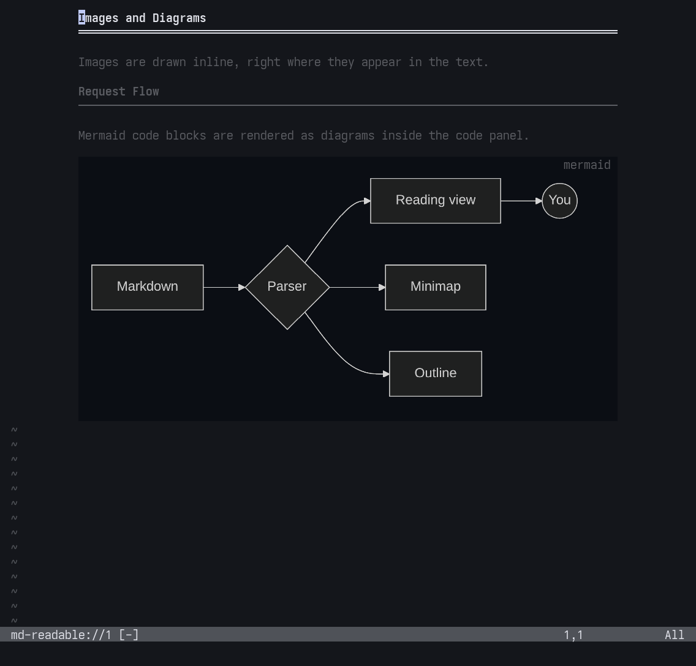
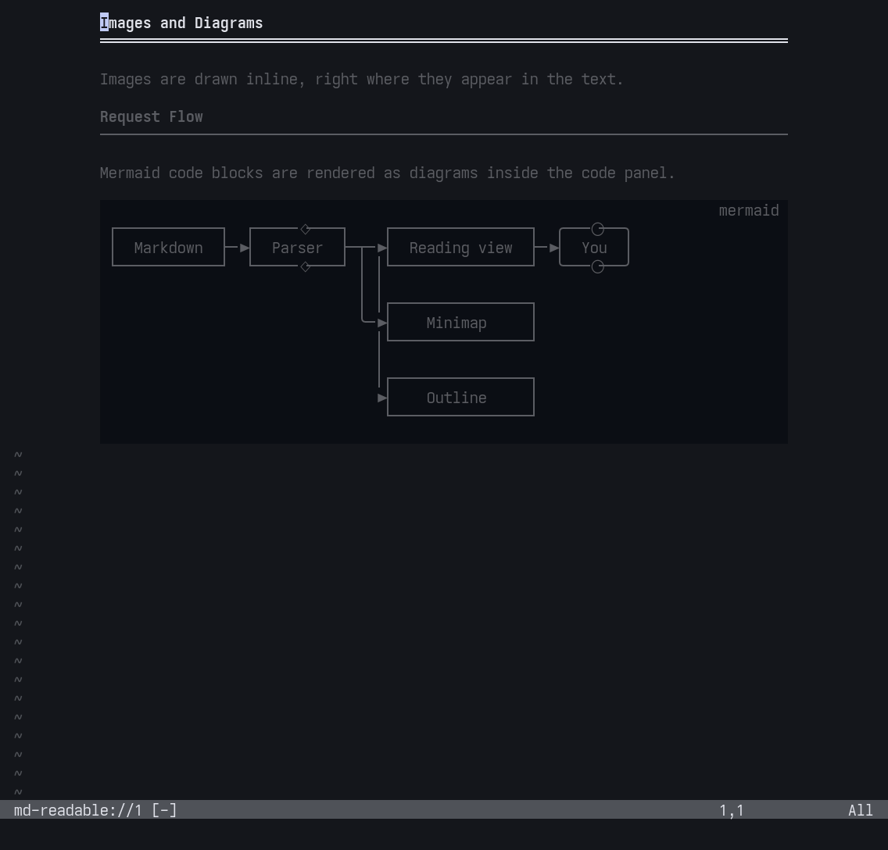

# md-readable.nvim

[日本語版](README_ja.md)

| Jump Link                          | SSG Index Navigation   |
| ---------------------------------- | ---------------------- |
|  |  |


| Focus Mode                      | Minimap Navigation             |
| -----------                     | -------                        |
|  |  |


| Mermaid(mmdc)                  | Termaid                              |
| ---------------                | -----------                          |
|  |  |

`md-readable` is built around navigation features for reading and understanding Markdown.
It provides a minimap, jumps across file links, index navigation for major SSGs, and more.

- `Navigation`
    - Heading tree
    - Minimap
    - Focus Mode
    - Navigation for major SSGs
        - Supported SSGs: mdBook, Docusaurus, MkDocs, Zensical, Astro/Starlight, HonKit, GitBook
- `Appearance`
    - Markdown syntax highlighting
    - Table rendering
    - Code blocks
    - Color theme switching
    - Truncated display of long text in tables / URLs (raw URLs in the text and the `links` list)
    - Link kind markers (external ↗, document →, anchor #, file ⧉, etc.)
- `Formatting`
    - Table formatting
    - Table row and column insertion/deletion
- `Contents`
    - Image display (png, jpg, svg, webp, etc.)
    - Mermaid diagram rendering (mmdc, termaid)

Some writing support is also included.


# Requirements
- Neovim >= 0.12
- Image display: a terminal that supports the Kitty graphics protocol
> [!NOTE]
> Works inside tmux with Kitty and Ghostty too (`allow-passthrough on`). Images are placed as placeholder text, so they scroll with the view and disappear when you switch tmux windows. WezTerm lacks placeholders, so images are shown as text instead.
- Optional: ImageMagick or similar for image conversion, an installed `mmdc` for Mermaid, and `curl` for explicitly allowed web images.
- Telescope / Snacks are needed only for their integrations. No tool is installed automatically.

# Usage

Load this repository with your plugin manager. For example, with lazy.nvim on the implementation branch:

```lua
{
  "takeshiD/md-readable.nvim",
  -- Keys that open a reading view (no global keymaps are installed, so map them here)
  keys = {
    { "<leader>mr", "<cmd>MdReadable<cr>", ft = "markdown", desc = "Reader: current window" },
    { "<leader>mv", "<cmd>MdReadable vert<cr>", ft = "markdown", desc = "Reader: vertical split" },
    { "<leader>mf", "<cmd>MdReadable float<cr>", ft = "markdown", desc = "Reader: float" },
  },
  opts = {
    -- Reading-buffer keymaps; override, add or disable defaults per key
    keymaps = {
      ["]]"] = { mode = "n", "actions.heading_next", desc = "Next Heading" },
      ["[["] = { mode = "n", "actions.heading_prev", desc = "Previous Heading" },
      ["go"] = { mode = "n", "actions.toggle_minimap", desc = "Toggle Minimap" },
      ["g?"] = { mode = "n", "actions.show_help", desc = "Show Help" },
      ["za"] = false, -- disable a default key
    },
    -- Feature switches (all default to true)
    links = { enable = true }, -- false: no link highlights or kind markers
    table = { enable = true }, -- false: show tables as their Markdown source
    focus = { enable = true }, -- start Focus mode when a reading view opens
    minimap = { enable = true }, -- open the minimap when a reading view opens
    images = { enable = true },
    mermaid = { enable = true },
  },
}
```

Open a Markdown file and run:

```vim
:MdReadable          " use the current window as the reading view
:MdReadable vert     " original on the left, reading view on the right
:MdReadable float    " floating reading view
:MdReadable source   " return to the corresponding original position
:MdReadable close
```

Setup is optional. See [Keymaps](#keymaps) for reading-buffer keys. Every action is also available as a command.

| Command after `MdReadable`                        | Action                                                                                              |
| ---                                               | ---                                                                                                 |
| `nav` / `outline` / `select`                      | Book tree, page headings, adapter/tree selection                                                    |
| `prev` / `next` / `heading-prev` / `heading-next` | Chapter/heading navigation                                                                          |
| `links` / `open`                                  | Floating link list (Enter open, o show in text, q close), or open the link/cell under the cursor    |
| `search [pattern]`                                | Search the original, including omitted text                                                         |
| `focus on/off/toggle`                             | Paragraph Focus; started with a Visual range, it fixes the focused lines                            |
| `theme default/dark/light`                        | Change only the reading view's colors                                                               |
| `minimap on/off/toggle/focus`                     | Minimap; moving in it scrolls the document, Enter returns there                                     |
| `table format`                                    | Align the original table explicitly                                                                 |
| `table row-before/row-after/row-delete [count]`   | Insert/delete data rows                                                                             |
| `table col-before/col-after/col-delete [count]`   | Insert/delete columns                                                                               |
| `expand` / `tab [index]`                          | Expand omitted content, select a static tab                                                         |
| `images allow/deny`                               | Permit/deny web image retrieval for this reading session                                            |
| `refresh` / `diagnostics`                         | Reload structure, inspect navigation/image errors                                                   |

Table edits are undoable and do not save the file. Copying decoration only leaves the registers unchanged. Copying a truncated cell including its `…` copies the whole original cell.

# Configuration

```lua
require("md-readable").setup({
  -- Layout: "integrated", "separate" or "ondemand"
  layout = "integrated",
  -- Body width; floats are at most width + 4 columns
  width = 100,
  -- Center the body in wider windows
  center = true,
  -- Reading-buffer keymaps; see Keymaps below
  keymaps = {},
  use_default_keymaps = true,

  links = {
    enable = true,
    -- Link kind markers: "unicode", "ascii", false, or a table per kind
    icons = "unicode",
  },
  table = {
    enable = true,
    max_cell_width = 28,
  },
  focus = {
    -- Start Focus mode when a reading view opens
    enable = true,
    coefficient = 0.5,
    span = 0,
  },
  minimap = {
    -- Open the minimap when a reading view opens
    enable = true,
    -- Moving in the minimap scrolls the document
    follow = true,
    width = 14,
    mode = "braille",
  },
  navigation = {
    -- Open the book tree with the reading view (former name: auto_open)
    enable = true,
    -- Moving over a heading scrolls the document (pages open with Enter)
    follow = true,
    -- How gn opens the book tree: "auto" (by width and layout), "sidebar" or "float"
    style = "auto",
    fold = {
      -- Fold keys: one key, a list of keys, or false (disabled)
      keys = {
        collapse = { "h", "<Left>" }, -- collapse (or go to the parent when collapsed)
        expand = { "l", "<Right>" },
        toggle = "za",
        collapse_recursive = "zC", -- collapse with all descendants
        expand_recursive = "zO", -- expand with all descendants
        collapse_all = "zM",
        expand_all = "zR",
      },
      -- Markers for fold state and the current page
      icons = { collapsed = "+ ", expanded = "- ", leaf = "  ", current = "> " },
    },
  },
  -- Image size (as in snacks.image): width/height fix the box (default: body width and
  -- window height), min_*/max_* bound it. Images keep their aspect ratio and are never
  -- enlarged past their own size
  images = {
    enable = true,
    remote = false,
    width = nil,
    height = nil,
    max_width = nil,
    max_height = 40,
  },
  mermaid = {
    enable = true,
    -- How diagrams are drawn: "mmdc" (images; Kitty, Ghostty) or "termaid" (Unicode text; any terminal)
    renderer = "mmdc",
    -- The renderer's command, arguments allowed (e.g. "uvx termaid"); nil: same name as renderer
    command = nil,
    -- Extra arguments for the renderer
    args = {},
    -- mmdc output scale
    scale = 3,
    -- Most rows a diagram fills
    max_rows = 40,
    -- mmdc-only options
    mmdc_opts = {
      -- Start mmdc's Chromium with --no-sandbox (see below); also theme, background, width, height
      no_sandbox = false,
    },
    -- termaid-only options: ascii, sharp_edges, inline_edge_labels (true) / gap, padding_x, padding_y (number)
    termaid_opts = {},
  },
  code = {
    -- Code block colors:
    --   "github-dark", "github-light", "ayu-dark", "ayu-light", "dracula",
    --   "catppuccin", "gruvbox-dark", "gruvbox-light", "tokyonight"
    theme = "github-dark",
    -- Single colors ("#rrggbb"):
    --   bg, fg, label, comment, keyword, string, number, constant, func,
    --   type, variable, parameter, property, operator, punctuation, tag
    colors = {},
    -- Position of the icon and language name: "left" (top left) or "right" (top right)
    label = "left",
    -- Language icon provider: "mini" (mini.icons) or "web-devicons"; nil shows no icon
    icons = "mini",
  },

  alerts = {
    -- false: plain "▌ Title" without icon or kind color
    enable = true,
    -- Icons: "auto" (GitHub's Octicons (Nerd Font) when mini.icons or nvim-web-devicons is
    --   installed, else Unicode symbols), "nerd", "unicode", or false (no icons)
    icons = "auto",
    -- Per kind: title, icon (false: none) and color ("#rrggbb" or a highlight group name)
    kinds = {
      note = { title = "Note" },
      tip = { title = "Tip" },
      important = { title = "Important" },
      warning = { title = "Warning" },
      caution = { title = "Caution" },
    },
    -- Aliases (MkDocs, Docusaurus, ... kind names) shown as the closest kind
    aliases = { info = "note", hint = "tip", danger = "caution" --[[, ...]] },
  },

  watch = {
    -- Reload the source when its file changes outside Neovim (another editor, git, ...)
    enable = true,
  },
  git = {
    -- Git status of the source in the sign column
    enable = true,
    signs = {
      -- text: 1-2 cells
      -- color: "#rrggbb" or a highlight group name (default Added/Changed/Removed)
      add = { text = "▎" },
      change = { text = "▎" },
      delete = { text = "▁" },
    },
  },

  -- adapters = { adapter = "mdbook", root_dir = "/path/to/book" },
})
```

Each feature section has an `enable` switch. `links.enable = false` shows link labels as plain text without highlights or kind markers (the link list and following still work); `table.enable = false` shows tables as their Markdown source; `focus.enable` and `minimap.enable` start Focus mode and the minimap whenever a reading view opens (toggle them afterwards with `gz` / `go`); `images.enable` and `mermaid.enable` turn media rendering off. The former `images.enabled` / `mermaid.enabled` keys are still accepted.

If Mermaid diagrams stay blank and `:MdReadable diagnostics` reports "Failed to launch the browser process" with a SUID sandbox message, mmdc's Chromium cannot use its sandbox (common with Nix-installed Chromium). `mermaid.mmdc_opts.no_sandbox = true` starts it with `--no-sandbox`; only use it for documents you trust.

`mermaid.command` runs the selected renderer; it may contain arguments, so a package runner works too, e.g. `command = "uvx termaid"` (a runner may download the tool; the defaults never do). With `mermaid.renderer = "termaid"`, diagrams are drawn as Unicode box-drawing text by [termaid](https://pypi.org/project/termaid/) inside the code block panel, so they also work in terminals without image support (WezTerm, SSH, plain tmux). The output is fitted to the panel width with `--width` and cached per diagram; when termaid is missing or cannot draw a diagram, the code is shown and `:MdReadable diagnostics` gives the reason.

Callouts — GitHub alerts (`> [!NOTE]`), MkDocs `!!! note` and Docusaurus `:::note` — show the kind's icon and title in its color. The defaults follow GitHub: its Octicons (`info`, `light-bulb`, `report`, `alert`, `stop`) as Nerd Font glyphs when mini.icons or nvim-web-devicons is installed (neither ships alert icons, so their presence is taken as a sign of a Nerd Font), Unicode symbols otherwise, and GitHub's alert colors for a dark or light background. Other admonition names (`info`, `danger`, ...) use the closest kind through `alerts.aliases`; add a kind to `alerts.kinds` to style it on its own. The groups are `MdReadableAlertNote`, `MdReadableAlertTip`, ... after the kind name.

```lua
alerts = {
  kinds = {
    note = { icon = "ℹ", color = "DiagnosticInfo" },
    warning = { title = "Heads up", color = "#e0af68" },
    danger = { icon = "✖", title = "Danger", color = "DiagnosticError" }, -- a kind of its own
  },
},
```

Images take the rows of their own size, fitted into the image box the way snacks.image does: `images.width`/`images.height` fix the box (by default the body width and the reading window height), `min_width`/`max_width`/`min_height`/`max_height` bound it, and the image keeps its aspect ratio without being enlarged. The cell size comes from the terminal. A converted or downloaded image is measured when it is first shown, then the view is redrawn once.

A Mermaid diagram is drawn inside its code block panel, in place of the code, under the same label row and background; when it cannot be drawn the code is shown. It fills the body width and gets the rows that keep its aspect ratio, up to `mermaid.max_rows`. Until a diagram is first generated it uses `images.height` rows (10 when unset), then the view is redrawn once. `mermaid.scale` is passed to mmdc so enlarged diagrams stay sharp.

Code blocks are drawn as a full-width panel whose background is the page background shifted slightly toward gray. `code.theme` applies a Shiki-derived palette to code blocks only (background included); `code.colors` overrides single colors on top of it, or on top of the colorscheme when no theme is set.

The reading view shows the Git status of the source in its sign column, next to the text: rows added, changed or deleted against the Git index (unsaved edits included) get a sign on the display rows that show them. A change on rows the view hides (blank lines, frontmatter, a deletion) marks the next shown row. Set the symbols and colors per kind, for example:

```lua
git = {
  signs = {
    add = { text = "+", color = "#3fb950" },
    change = { text = "~", color = "DiagnosticWarn" }, -- a group name: use that group's colors
    delete = { text = "_" },                          -- no color: keep Removed
  },
},
```

`git = { enable = false }` turns the signs and the sign column off.

Navigation follows the book's content directory (the deepest directory holding all pages of the contents, such as `src/` or a GitBook space directory). A file outside it, like a repository README next to `gitbook-docs.yaml`, gets no book tree, only its own headings. A page inside it that is not in the contents shows its headings above the book tree.

`layout` decides how the book tree (`gn`) and the page headings (`gO`) are arranged.

| `layout`                 | When a reading view opens                                                               | Book tree contents                                   |
| ------------------------ | --------------------------------------------------------------------------------------- | ---------------------------------------------------- |
| `"integrated"` (default) | Opens the book tree as a left sidebar                                                   | The current page's headings, folded, under its entry |
| `"separate"`             | Opens the book tree on the left and the page headings on the right (when there is room) | Pages only; headings live in the right panel         |
| `"ondemand"`             | Opens nothing; `gn` opens a floating tree by default (`navigation.style = "auto"`)      | Same as `"integrated"`                               |

The book tree opens by itself only when `navigation.enable = true` and a page of a recognized book is opened with `:MdReadable` or `:MdReadable vert`. With `"separate"`, a page that is not in the contents shows its headings in the right panel instead of above the book tree.

At narrow widths, navigation uses a floating chooser to preserve the reading area. Nerd Font glyphs are not required; an ASCII minimap mode is available.

Dynamic SSG configuration is not executed. Supply a custom Lua/JSON navigation provider when needed; see `:help md-readable-providers` and the [SSG compatibility table](tests/fixtures/navigation/SUPPORTED.md).

# Keymaps

No global keymaps are installed; map the keys that open a reading view with `keys`, as in the lazy.nvim example above. Reading buffers get these keymaps by default. Press `g?` to list the active keymaps. The same keymaps also work in the navigation, minimap and links panels; there the panel keys (`<CR>`, `q`, `<Esc>`, `h`/`l`, ...) take precedence on the same key.

| Key         | Action                                          | Description                                            |
| ---         | ---                                             | ---                                                    |
| `q`         | `actions.close`                                 | Close the reading view                                 |
| `<CR>`      | `actions.open`                                  | Open the link, cell, tab or details at the cursor      |
| `g?`        | `actions.show_help`                             | List keymaps                                           |
| `gs`        | `actions.source`                                | Jump to the source position                            |
| `]]` / `[[` | `actions.heading_next` / `actions.heading_prev` | Next / previous heading                                |
| `]p` / `[p` | `actions.next_page` / `actions.prev_page`       | Next / previous page                                   |
| `gn`        | `actions.toggle_nav`                            | Book tree                                              |
| `gO`        | `actions.outline`                               | Page headings                                          |
| `gl`        | `actions.links`                                 | Link list                                              |
| `g/`        | `actions.search`                                | Search the source, including omitted text              |
| `gz`        | `actions.toggle_focus`                          | Toggle Focus; in Visual mode, focus the selected lines |
| `go`        | `actions.toggle_minimap`                        | Minimap                                                |
| `za`        | `actions.expand`                                | Expand or collapse omitted content                     |

You can also map

- `actions.select`
- `actions.focus_minimap`
- `actions.next_tab`
- `actions.refresh`
- `actions.diagnostics`
- `actions.toggle_nav_float`
- `actions.toggle_nav_sidebar`

Actions can also be called from a function keymap: `require("md-readable.actions").toggle_nav({ float = true })` opens the book tree in a floating window.
For further customization, configure it like this:

```lua
keymaps = {
    ["gN"] = { mode = "n", function()
            require("md-readable.actions").toggle_nav({float = true})
        end,
        desc = "Toggle Nav on Floating Window"
    }
}
```

`:MdReadable nav float|sidebar` does the same. `:MdReadable outline sidebar` opens the page headings as a right sidebar instead of the default floating window. These keys are always installed and are not configured here:

- `y` / `Y`: copy the corresponding Markdown source
- `/` `?` `n` `N`: search the displayed text
- Ctrl-O / Ctrl-I: follow the source jumplist

Each `keymaps` value can be:

```lua
keymaps = {
  ["gh"] = "actions.show_help", -- an action name
  ["<leader>x"] = function() vim.cmd("MdReadable theme dark") end, -- a function
  ["gz"] = { "actions.toggle_focus", mode = { "n", "x" }, desc = "Focus", nowait = true }, -- mode, desc and vim.keymap.set opts
  ["q"] = false, -- disable a default
}
```

Set `use_default_keymaps = false` to install only the keys you list, or `keymaps = false` to install no reading-buffer keymaps.

# Inspired
- [render-markdown.nvim](https://github.com/meanderingprogrammer/render-markdown.nvim)
- [limelight.vim](https://github.com/junegunn/limelight.vim)
- [zen-mode.nvim](https://github.com/folke/zen-mode.nvim)
- [md-render.nvim](https://github.com/delphinus/md-render.nvim)


# License
MIT
