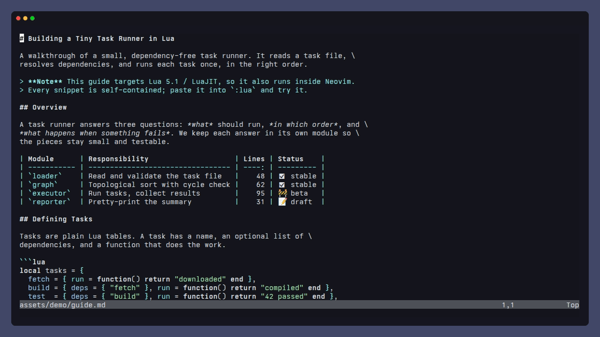
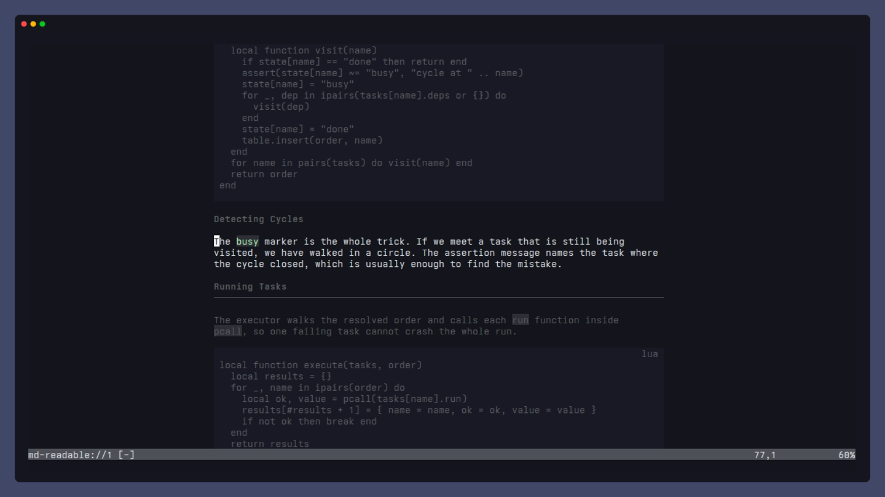
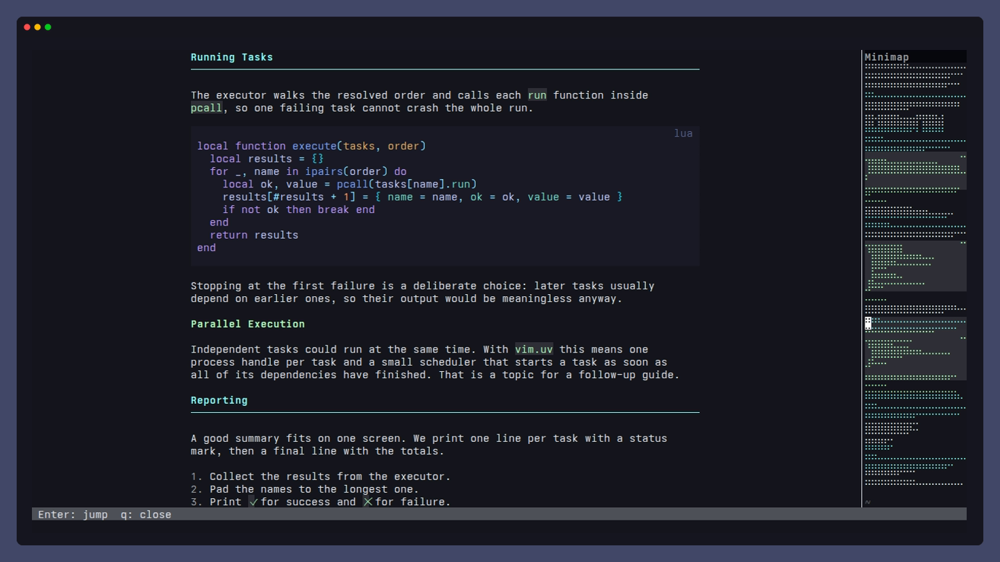
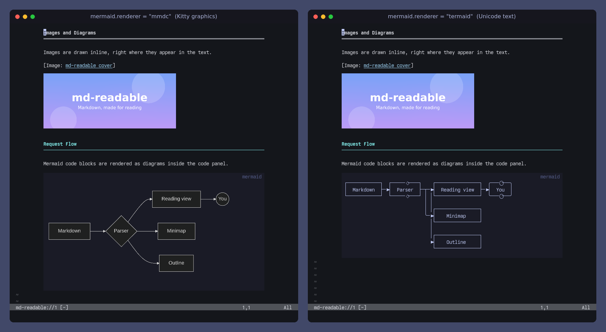
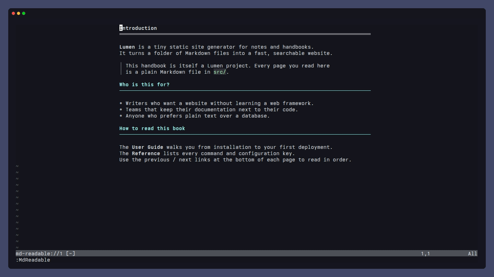

# md-readable.nvim

[日本語版](README_ja.md)



<table>
  <tr>
    <td></td>
    <td></td>
  </tr>
  <tr>
    <td align="center">Focus mode dims everything but the current paragraph</td>
    <td align="center">Minimap with headings and code blocks in color</td>
  </tr>
</table>





The demos are recorded with [VHS](https://github.com/charmbracelet/vhs); see `assets/tapes/`.

A Neovim plugin specialized in making Markdown easy to read.
Read Markdown in a separate, read-only view while keeping the original text and unsaved edits intact. The implementation includes the features below; SSG support covers the [documented static subsets](tests/fixtures/navigation/SUPPORTED.md).

- Appearance
    - Markdown syntax highlighting
    - Table rendering
    - Code blocks
    - Color theme switching for the reading view only
    - Truncated display of long text in tables / URLs
    - Link kind markers (external ↗, document →, anchor #, file ⧉; ASCII or off via `links.icons`)
- Navigation
    - Minimap
        - Headings and code blocks in color; moving in it scrolls the document
    - Heading tree
    - Focus Mode
    - Table of contents and previous/next navigation for major SSGs
        - mdBook, Docusaurus, MkDocs, Zensical, Astro/Starlight, HonKit, GitBook
- Formatting
    - Table formatting
    - Explicit table row and column insertion/deletion
- Contents
    - Image display (png, jpg, svg, webp, etc.)
    - Mermaid diagram rendering
- Integration
    - Telescope and Snacks previewers (optional picker dependencies)

Some writing support is also included.
- Writing
    - Bidirectional cursor and page synchronization between the Read Buffer and the Write Buffer

The reading view will search displayed text with `/` and copy the corresponding Markdown source with `y`. Selecting part of a link label copies that text; selecting the entire label copies the original Markdown link. A separate command will search the full source, including omitted content. Reading positions will not be persisted across Neovim sessions.

The reference plugins listed in AGENTS.md are implementation references, not required dependencies. Rendering, Focus, table editing, and the minimap are implemented inside this plugin.

See the [agreed specification](docs/final-spec-review.md), [implementation tracker](https://github.com/takeshiD/md-readable.nvim/issues/33), and [verification notes](docs/verification.md).

# Requirements
- Neovim >= 0.12
- Inline images require a terminal with Kitty graphics Unicode placeholders: Kitty or Ghostty, also inside tmux (`allow-passthrough on`). Images are placeholder text, so they scroll with the view and disappear when you switch tmux windows. WezTerm lacks placeholders and gets the text fallback.
- Optional: ImageMagick/rsvg-convert/FFmpeg for image conversion; installed `mmdc` for Mermaid; `curl` for explicitly allowed web images.
- Telescope and Snacks are optional, only for their preview integrations. No reference plugin is required and no tool is automatically installed.

# Quick start

Load this repository with your plugin manager. For example, while this implementation is on its feature branch:

```lua
{
  "takeshiD/md-readable.nvim",
  -- Keys that open a reading view (no global keymaps are installed, so map them here)
  keys = {
    { "<leader>mr", "<cmd>MdReadable<cr>", ft = "markdown", desc = "Reader: current window" },
    { "<leader>mv", "<cmd>MdReadable vert<cr>", ft = "markdown", desc = "Reader: vertical split" },
    { "<leader>mf", "<cmd>MdReadable float<cr>", ft = "markdown", desc = "Reader: float" },
  },
  opts = {
    -- Reading-buffer keymaps, merged per key with the defaults
    keymaps = {
      ["]]"] = { mode = "n", "actions.heading_next", desc = "Next Heading" },
      ["[["] = { mode = "n", "actions.heading_prev", desc = "Previous Heading" },
      ["go"] = { mode = "n", "actions.toggle_minimap", desc = "Toggle Minimap" },
      ["g?"] = { mode = "n", "actions.show_help", desc = "Show Help" },
      ["za"] = false, -- disable a default key
    },
    -- Feature switches (all default to true)
    links = { enable = true }, -- false: plain link labels without highlights or markers
    table = { enable = true }, -- false: show tables as their Markdown source
    focus = { enable = true }, -- start Focus mode when a reading view opens
    minimap = { enable = true }, -- open the minimap when a reading view opens
    images = { enable = true },
    mermaid = { enable = true },
  },
}
```

Open a Markdown file and run one of:

```vim
:MdReadable          " use the current window
:MdReadable vert     " original on the left, reading view on the right
:MdReadable float    " floating reading view
:MdReadable source   " return to the corresponding original position
:MdReadable close
```

Setup is optional. See [Keymaps](#keymaps) for reading-buffer keys; every action is also available as a command.

| Command after `MdReadable`                      | Action                                                                                          |
| ---                                             | ---                                                                                             |
| `nav`, `outline`, `select`                      | Book tree, page headings, adapter/tree selection                                                |
| `prev`, `next`, `heading-prev`, `heading-next`  | Chapter/heading navigation                                                                      |
| `links`, `open`                                 | Floating link list (Enter open, o show in text, q close) or open the item/cell under the cursor |
| `search [pattern]`                              | Search the complete original, including hidden text                                             |
| `focus on/off/toggle`                           | Limelight-style paragraph focus; a visual range fixes the focused lines                         |
| `theme default/dark/light`                      | Change only the reading window's colors                                                         |
| `minimap on/off/toggle/focus`                   | Minimap; moving in it scrolls the document, Enter returns there                                 |
| `table format`                                  | Align the original table explicitly                                                             |
| `table row-before/row-after/row-delete [count]` | Insert/delete data rows                                                                         |
| `table col-before/col-after/col-delete [count]` | Insert/delete columns                                                                           |
| `expand`, `tab [index]`                         | Expand omitted content or select a static tab                                                   |
| `images allow/deny`                             | Permit/deny web image retrieval for this reading session                                        |
| `refresh`, `diagnostics`                        | Reload structure or inspect navigation/media errors                                             |

Table edits are undoable and do not save the file. Decoration-only selections do not overwrite registers. Selecting a cell's ellipsis copies the complete original cell.

# Configuration

```lua
require("md-readable").setup({
  layout = "integrated", -- integrated, separate, ondemand
  width = 100, -- body width; floats are at most width + 4 columns
  center = true, -- center the body in wider windows
  links = { enable = true, icons = "unicode" }, -- "ascii", false, or a table of markers per kind
  keymaps = {}, -- reading-buffer keymaps; see Keymaps below
  use_default_keymaps = true,
  table = { enable = true, max_cell_width = 28 },
  focus = { enable = true, coefficient = 0.5, span = 0 },
  minimap = { enable = true, follow = true, width = 12, mode = "braille" }, -- follow: moving in it scrolls the view
  navigation = {
    enable = true, -- open the book tree with the reading view (former name: auto_open)
    follow = true, -- moving over a heading in a navigation panel scrolls the view; pages open with Enter
    style = "auto", -- how gn opens the book tree: "auto" (by width and layout), "sidebar" or "float"
    fold = {
      -- one key, a list, or false per action
      keys = {
        collapse = { "h", "<Left>" }, -- collapse, or go to the parent
        expand = { "l", "<Right>" },
        toggle = "za",
        collapse_recursive = "zC",
        expand_recursive = "zO",
        collapse_all = "zM",
        expand_all = "zR",
      },
      icons = { collapsed = "+ ", expanded = "- ", leaf = "  ", current = "> " },
    },
  },
  images = { enable = true, remote = false, height = 10 },
  mermaid = {
    enable = true,
    renderer = "mmdc", -- "mmdc": images (Kitty/Ghostty); "termaid": Unicode text in any terminal
    command = nil, -- the renderer's command, arguments allowed ("uvx termaid"); nil: "mmdc" / "termaid"
    args = {}, -- extra arguments for the renderer
    scale = 3, -- mmdc output scale
    max_rows = 40, -- most rows a diagram fills
    mmdc_opts = {
      no_sandbox = false, -- see below; also theme, background, width, height
    },
    termaid_opts = {}, -- ascii, sharp_edges, inline_edge_labels (true) / gap, padding_x, padding_y (number)
  },
  code = {
    theme = nil, -- code block syntax colors: "github-dark", "github-light", "ayu-dark", "ayu-light",
    --              "dracula", "catppuccin", "gruvbox-dark", "gruvbox-light", "tokyonight"
    colors = {}, -- "#rrggbb" per key: bg, fg, label, comment, keyword, string, number, constant,
    --              func, type, variable, parameter, property, operator, punctuation, tag
    label = "left", -- icon and language in the "left" or "right" top corner
    icons = nil, -- language icon provider: "mini" (mini.icons) or "web-devicons"; nil shows none
  },
  watch = { enable = true }, -- reload the source when its file changes outside Neovim
  git = {
    enable = true, -- Git status of the source in the sign column
    signs = {
      -- text: 1-2 cells; color: "#rrggbb" or a highlight group name (default Added/Changed/Removed)
      add = { text = "▎" },
      change = { text = "▎" },
      delete = { text = "▁" },
    },
  },
  -- adapters = { adapter = "mdbook", root_dir = "/path/to/book" },
})
```

Each feature section has an `enable` switch. `links.enable = false` shows link labels as plain text without highlights or kind markers (the link list and following still work); `table.enable = false` shows tables as their Markdown source; `focus.enable` and `minimap.enable` start Focus mode and the minimap whenever a reading view opens (toggle them afterwards with `gz` / `go`); `images.enable` and `mermaid.enable` turn media rendering off. The former `images.enabled` / `mermaid.enabled` keys are still accepted.

If Mermaid diagrams stay blank and `:MdReadable diagnostics` reports "Failed to launch the browser process" with a SUID sandbox message, mmdc's Chromium cannot use its sandbox (common with Nix-installed Chromium). `mermaid.mmdc_opts.no_sandbox = true` starts it with `--no-sandbox`; only use it for documents you trust.

`mermaid.command` runs the selected renderer; it may contain arguments, so a package runner works too, e.g. `command = "uvx termaid"` (a runner may download the tool; the defaults never do). With `mermaid.renderer = "termaid"`, diagrams are drawn as Unicode box-drawing text by [termaid](https://pypi.org/project/termaid/) inside the code block panel, so they also work in terminals without image support (WezTerm, SSH, plain tmux). The output is fitted to the panel width with `--width` and cached per diagram; when termaid is missing or cannot draw a diagram, the code is shown and `:MdReadable diagnostics` gives the reason.

A Mermaid diagram is drawn inside its code block panel, in place of the code, under the same label row and background; when it cannot be drawn the code is shown. It fills the body width and gets the rows that keep its aspect ratio, up to `mermaid.max_rows`. Until a diagram is first generated it uses `images.height` rows, then the view is redrawn once. `mermaid.scale` is passed to mmdc so enlarged diagrams stay sharp.

Code blocks are drawn as a full-width panel whose background is the page background shifted slightly toward gray. `code.theme` applies a Shiki-derived palette to code blocks only (background included); `code.colors` overrides single colors on top of it, or on top of the colorscheme when no theme is set.

The reading view shows the Git status of the source in its sign column, next to the text: rows added, changed or deleted against the Git index (unsaved edits included) get a sign on the display rows that show them. A change on rows the view hides (blank lines, frontmatter, a deletion) marks the next shown row. Set the symbols and colors per kind, for example:

```lua
git = {
  signs = {
    add = { text = "+", color = "#3fb950" },
    change = { text = "~", color = "DiagnosticWarn" }, -- a group name: use that group's colors
    delete = { text = "_" },                          -- no color: keep Removed
  },
},
```

`git = { enable = false }` turns the signs and the sign column off.

Navigation follows the book's content directory (the deepest directory holding all pages of the contents, such as `src/` or a GitBook space directory). A file outside it, like a repository README next to `gitbook-docs.yaml`, gets no book tree, only its own headings. A page inside it that is not in the contents shows its headings above the book tree.

At narrow widths, navigation uses a floating chooser to preserve the reading area. Nerd Font glyphs are not required; an ASCII minimap mode is available.

Dynamic SSG configuration is not executed. Supply a custom Lua/JSON navigation provider when needed; see `:help md-readable-providers` and the [SSG compatibility table](tests/fixtures/navigation/SUPPORTED.md).

# Keymaps

No global keymaps are installed; map the commands that open a reading view yourself, as in the lazy.nvim example above. Reading buffers get these defaults. Press `g?` to list the active keymaps. The same keymaps also work in the navigation, minimap and links panels; there the panel keys (`<CR>`, `q`, `<Esc>`, `h`/`l`, ...) take precedence on the same key.

| Key         | Action                                          | Description                                            |
| ---         | ---                                             | ---                                                    |
| `q`         | `actions.close`                                 | Close the reading view                                 |
| `<CR>`      | `actions.open`                                  | Open the link, cell, tab or details at the cursor      |
| `g?`        | `actions.show_help`                             | List keymaps                                           |
| `gs`        | `actions.source`                                | Jump to the source position                            |
| `]]` / `[[` | `actions.heading_next` / `actions.heading_prev` | Next / previous heading                                |
| `]p` / `[p` | `actions.next_page` / `actions.prev_page`       | Next / previous page                                   |
| `gO`        | `actions.outline`                               | Page headings                                          |
| `gl`        | `actions.links`                                 | Document links                                         |
| `g/`        | `actions.search`                                | Search the source, including omitted text              |
| `gz`        | `actions.toggle_focus`                          | Toggle Focus; in Visual mode, focus the selected lines |
| `go`        | `actions.toggle_minimap`                        | Toggle Minimap                                         |
| `gn`        | `actions.toggle_nav`                            | Toggle Book navigation                                 |
| `za`        | `actions.expand`                                | Expand or collapse omitted content                     |

`actions.select`, `actions.focus_minimap`, `actions.next_tab`, `actions.refresh`, `actions.diagnostics`, `actions.toggle_nav_float` and `actions.toggle_nav_sidebar` are also available. Action names accept `-` or `_` (`actions.heading-next` works too). Actions can also be called from a function keymap, e.g. `require("md-readable.actions").toggle_nav({ float = true })` (`float = false` for a sidebar, omitted to choose by width and `layout`); `:MdReadable nav float|sidebar` does the same. These keys are always installed and are not configured here:

- `y` / `Y`: copy the corresponding Markdown source
- `/` `?` `n` `N`: search the displayed text
- Ctrl-O / Ctrl-I: follow the source jumplist

Each `keymaps` value can be:

```lua
keymaps = {
  ["gh"] = "actions.show_help", -- an action name
  ["<leader>x"] = function() vim.cmd("MdReadable theme dark") end, -- a function
  ["gz"] = { "actions.toggle_focus", mode = { "n", "x" }, desc = "Focus", nowait = true }, -- mode, desc and vim.keymap.set opts
  ["q"] = false, -- disable a default
}
```

Set `use_default_keymaps = false` to install only the keys you list, or `keymaps = false` to install no reading-buffer keymaps.

# Inspired
- [render-markdown.nvim](https://github.com/meanderingprogrammer/render-markdown.nvim)
- [limelight.vim](https://github.com/junegunn/limelight.vim)
- [zen-mode.nvim](https://github.com/folke/zen-mode.nvim)
- [md-render.nvim](https://github.com/delphinus/md-render.nvim)


# License
MIT
