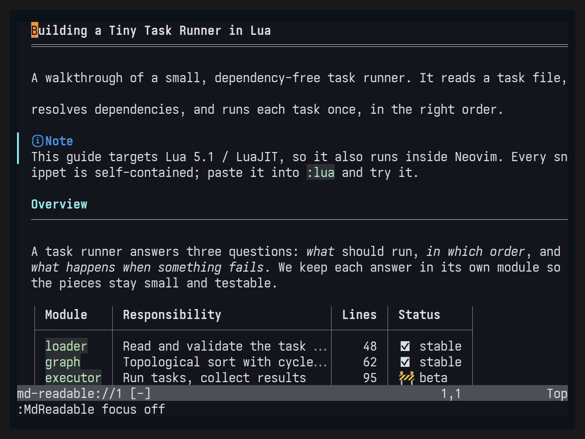

# md-readable.nvim

[English version](README.md)





このプラグインはmarkdownを読解するための多くの機能を特徴とします。

- `Appearance`
    - markdown構文ハイライト
    - テーブルレンダリング
    - コードブロック
    - カラーテーマ切り替え
    - テーブル内/URLの長文省略表示（本文の生URLと`links`一覧）
    - リンク種別マーカー（外部 ↗、文書 →、アンカー #、ファイル ⧉。など)
- `Navigation`
    - 見出しツリー
    - ミニマップ
    - Focus Mode
    - 主要SSGに対応したナビゲーション
        - 対応SSG: mdBook, Docusaurus, MkDocs, Zensical, Astro/Starlight, HonKit, GitBook
- `Formatting`
    - テーブル整形
    - 表の行・列の挿入削除
- `Contents`
    - 画像表示(png,jpg,svg,webpなど)
    - Mermaidダイアグラムレンダリング(mmdc, termaid)

一部Writingサポートも備えています。


# Requirements
- Neovim >= 0.12
- 画像表示: Kitty graphics protocolに対応した端末が必要
> [!NOTE]
> KittyとGhosttyに対応したtmuxの中でも使えます（`allow-passthrough on`）。画像は代わり文字として置くので、スクロールに追従し、tmuxでウィンドウを切り替えれば消えます。WezTermは代わり文字に対応していないため、画像の代わりに文字で表示します。
- 任意依存: 画像変換にImageMagick等、Mermaidに導入済みの`mmdc`、許可した外部画像の取得に`curl`。
- Telescope / Snacksは連携を利用する場合だけ必要です。ツールを自動インストールすることはありません。

# 使い方

プラグインマネージャーでこのリポジトリを読み込みます。実装ブランチを使うlazy.nvimの例:

```lua
{
  "takeshiD/md-readable.nvim",
  -- 読書表示を開くキー（グローバルキーマップは追加しないので、ここで割り当てる）
  keys = {
    { "<leader>mr", "<cmd>MdReadable<cr>", ft = "markdown", desc = "Reader: 同じウィンドウ" },
    { "<leader>mv", "<cmd>MdReadable vert<cr>", ft = "markdown", desc = "Reader: 左右分割" },
    { "<leader>mf", "<cmd>MdReadable float<cr>", ft = "markdown", desc = "Reader: float" },
  },
  opts = {
    -- 読書bufferのキーマップ。既定値に対してキー単位で上書き・追加・無効化する
    keymaps = {
      ["]]"] = { mode = "n", "actions.heading_next", desc = "Next Heading" },
      ["[["] = { mode = "n", "actions.heading_prev", desc = "Previous Heading" },
      ["go"] = { mode = "n", "actions.toggle_minimap", desc = "Toggle Minimap" },
      ["g?"] = { mode = "n", "actions.show_help", desc = "Show Help" },
      ["za"] = false, -- 既定のキーを無効化
    },
    -- 各機能の有効・無効（既定はすべてtrue）
    links = { enable = true }, -- false: リンクの強調表示と種別記号を出さない
    table = { enable = true }, -- false: 表を整形せずMarkdownのまま表示
    focus = { enable = true }, -- 読書表示を開いた時点でFocusを有効にする
    minimap = { enable = true }, -- 読書表示を開いた時点でミニマップを表示する
    images = { enable = true },
    mermaid = { enable = true },
  },
}
```

Markdownを開いて実行します。

```vim
:MdReadable          " 同じウィンドウを読書表示にする
:MdReadable vert     " 左に原文、右に読書表示
:MdReadable float    " floatingで読書表示
:MdReadable source   " 対応する原文の位置へ戻る
:MdReadable close
```

setupは任意です。読書bufferのキーマップは[キーマップ](#キーマップ)を参照してください。各操作はコマンドとしても実行できます。

| `MdReadable`の後に続ける操作                      | 内容                                                                                           |
| ---                                               | ---                                                                                            |
| `nav` / `outline` / `select`                      | 書籍目次、ページ見出し、adapter・treeの選択                                                    |
| `prev` / `next` / `heading-prev` / `heading-next` | 章・見出し移動                                                                                 |
| `links` / `open`                                  | リンク一覧のfloat（Enterで開く、oで本文の位置へ、qで閉じる）、カーソル位置のリンク・セルを開く |
| `search [pattern]`                                | 省略した内容を含む原文検索                                                                     |
| `focus on/off/toggle`                             | 段落Focus。Visual範囲を指定して起動すると行範囲を固定                                          |
| `theme default/dark/light`                        | 読書表示だけの配色変更                                                                         |
| `minimap on/off/toggle/focus`                     | ミニマップ。カーソル移動で本文が追従、Enterで本文へ戻る                                        |
| `table format`                                    | 原文の表を明示的に整列                                                                         |
| `table row-before/row-after/row-delete [count]`   | データ行の挿入・削除                                                                           |
| `table col-before/col-after/col-delete [count]`   | 列の挿入・削除                                                                                 |
| `expand` / `tab [index]`                          | 省略内容の展開、静的タブの選択                                                                 |
| `images allow/deny`                               | この読書Sessionでの外部画像取得の許可・禁止                                                    |
| `refresh` / `diagnostics`                         | 構造の再取得、ナビゲーション・画像エラーの確認                                                 |

表編集はundoで戻せ、自動保存しません。装飾だけをコピーした場合はレジスタを変更しません。省略セルの`…`を含めてコピーすると、元のセル全体を取得します。

# 設定

```lua
require("md-readable").setup({
  -- 配置: "integrated"・"separate"・"ondemand"
  layout = "integrated",
  -- 本文幅。floatは最大でwidth + 4列
  width = 100,
  -- 広いwindowでは本文を中央に寄せる
  center = true,
  -- 読書bufferのキーマップ。後述の「キーマップ」を参照
  keymaps = {},
  use_default_keymaps = true,

  links = {
    enable = true,
    -- リンク種別の記号: "unicode"・"ascii"・false・種別ごとの表
    icons = "unicode",
  },
  table = {
    enable = true,
    max_cell_width = 28,
  },
  focus = {
    -- 読書表示を開いた時点でFocusを有効にする
    enable = true,
    coefficient = 0.5,
    span = 0,
  },
  minimap = {
    -- 読書表示を開いた時点でミニマップを表示する
    enable = true,
    -- ミニマップでカーソルを動かすと本文が追従する
    follow = true,
    width = 14,
    mode = "braille",
  },
  navigation = {
    -- 読書表示を開いた時点で目次を表示する（以前の名前はauto_open）
    enable = true,
    -- 見出しにカーソルを合わせると本文が追従する（ページはEnterで開く）
    follow = true,
    -- gnで目次を開く方法: "auto"（画面幅とlayoutで決める）・"sidebar"・"float"
    style = "auto",
    fold = {
      -- 折りたたみのキー。キー1つ・キーの配列・false（無効）で指定
      keys = {
        collapse = { "h", "<Left>" }, -- 閉じる（閉じていれば親へ移動）
        expand = { "l", "<Right>" },
        toggle = "za",
        collapse_recursive = "zC", -- 配下もまとめて閉じる
        expand_recursive = "zO", -- 配下もまとめて開く
        collapse_all = "zM",
        expand_all = "zR",
      },
      -- 開閉状態などの記号
      icons = { collapsed = "+ ", expanded = "- ", leaf = "  ", current = "> " },
    },
  },
  -- 画像の大きさ（snacks.imageと同じ考え方）: width・heightで枠を固定し（既定は本文幅と窓の高さ）、
  -- min_*・max_*で範囲を決める。画像は縦横比を保ち、元の大きさより拡大しない
  images = {
    enable = true,
    remote = false,
    width = nil,
    height = nil,
    max_width = nil,
    max_height = 40,
  },
  mermaid = {
    enable = true,
    -- 図の描き方: "mmdc"（画像。Kitty・Ghostty）・"termaid"（Unicodeの文字。どの端末でも表示できる）
    renderer = "mmdc",
    -- 描画ツールのコマンド。引数を含めてもよい（例: "uvx termaid"）。nilならrendererと同じ名前
    command = nil,
    -- 描画ツールに追加で渡す引数
    args = {},
    -- mmdcの出力倍率
    scale = 3,
    -- 図が使う行数の上限
    max_rows = 40,
    -- mmdcだけの設定
    mmdc_opts = {
      -- mmdcのChromiumを--no-sandboxで起動する（後述）。ほかにtheme・background・width・height
      no_sandbox = false,
    },
    -- termaidだけの設定: ascii・sharp_edges・inline_edge_labels（true）、gap・padding_x・padding_y（数値）
    termaid_opts = {},
  },
  code = {
    -- コードブロックの配色:
    --   "github-dark"・"github-light"・"ayu-dark"・"ayu-light"・"dracula"・
    --   "catppuccin"・"gruvbox-dark"・"gruvbox-light"・"tokyonight"
    theme = "github-dark",
    -- 個別の色（"#rrggbb"）:
    --   bg・fg・label・comment・keyword・string・number・constant・func・
    --   type・variable・parameter・property・operator・punctuation・tag
    colors = {},
    -- アイコンと言語名の位置: "left"（左上）・"right"（右上）
    label = "left",
    -- 言語アイコンの取得元: "mini"（mini.icons）・"web-devicons"。nilならアイコンなし
    icons = "mini",
  },

  alerts = {
    -- falseなら、アイコンと種類ごとの色を付けずに「▌ 見出し」で表示する
    enable = true,
    -- アイコンの種類: "auto"（mini.iconsかnvim-web-deviconsがあればGitHubと同じOcticons（Nerd Font）、
    --   なければUnicodeの記号）・"nerd"・"unicode"・false（アイコンなし）
    icons = "auto",
    -- 種類ごとの見出し・アイコン（falseで非表示）・色（"#rrggbb"か強調表示グループ名）
    kinds = {
      note = { title = "Note" },
      tip = { title = "Tip" },
      important = { title = "Important" },
      warning = { title = "Warning" },
      caution = { title = "Caution" },
    },
    -- 別名（MkDocs・Docusaurusなどの種類名）を近い種類の表示にそろえる
    aliases = { info = "note", hint = "tip", danger = "caution" --[[, ...]] },
  },

  watch = {
    -- 原文ファイルが外部（別のエディターやgitなど）で更新されたら読み込み直して反映する
    enable = true,
  },
  git = {
    -- 原文のGitの差分をsign columnに表示する
    enable = true,
    signs = {
      -- text: 1〜2桁の記号
      -- color: "#rrggbb"か強調表示グループ名（省略時はAdded・Changed・Removed）
      add = { text = "▎" },
      change = { text = "▎" },
      delete = { text = "▁" },
    },
  },

  -- adapters = { adapter = "mdbook", root_dir = "/path/to/book" },
})
```

各機能の`enable`で有効・無効を切り替えます。`links.enable = false`ではリンクの強調表示と種別記号を出さず、ラベルを本文として表示します（リンク一覧と移動は使えます）。`table.enable = false`では表を整形せずMarkdownのまま表示します。`focus.enable`と`minimap.enable`は読書表示を開いた時点でFocusとミニマップを有効にします（開いた後は`gz`・`go`で切り替え）。`images.enable`・`mermaid.enable`は画像・Mermaidの描画を切り替えます。以前の`images.enabled`・`mermaid.enabled`も引き続き使えます。

Mermaidの図が表示されず、`:MdReadable diagnostics`に「Failed to launch the browser process」とSUID sandboxのエラーが出る場合は、mmdcが使うChromiumの隔離機能が動いていません（NixでChromiumを導入した環境でよく起きます）。`mermaid.mmdc_opts.no_sandbox = true`にすると`--no-sandbox`で起動します。隔離機能を切るため、信頼できる文書にだけ使ってください。

`mermaid.command`は選んだ描画ツールを起動するコマンドで、引数を含められます。`command = "uvx termaid"`のようなパッケージ実行ツールも使えます（その場合はツールが自動で取得されることがあります。既定のコマンドは何も取得しません）。`mermaid.renderer = "termaid"`にすると、[termaid](https://pypi.org/project/termaid/)で図をUnicodeの罫線の文字として描き、コードブロックの枠の中に表示します。画像を表示できない端末（WezTerm、SSH先、tmuxなど）でも使えます。図は`--width`で枠の幅に合わせ、図ごとに結果を使い回します。termaidがない、または描けない図の場合はコードを表示し、理由は`:MdReadable diagnostics`で確認できます。

コールアウト（GitHubのアラート`> [!NOTE]`、MkDocsの`!!! note`、Docusaurusの`:::note`）には、種類ごとのアイコンと見出しを種類の色で表示します。既定はGitHubに合わせています。アイコンはGitHubと同じOcticons（`info`・`light-bulb`・`report`・`alert`・`stop`）のNerd Font版で、mini.iconsかnvim-web-deviconsがあるときに使います（どちらもアラート用のアイコンは持たないため、入っていることをNerd Fontがある目安にしています）。ないときはUnicodeの記号を使います。色はGitHubのアラートの色で、背景が暗いか明るいかで切り替えます。ほかの種類名（`info`・`danger`など）は`alerts.aliases`で近い種類の表示になります。独自の表示にしたい種類は`alerts.kinds`に追加してください。強調表示グループは種類名から`MdReadableAlertNote`・`MdReadableAlertTip`のように決まります。

```lua
alerts = {
  kinds = {
    note = { icon = "ℹ", color = "DiagnosticInfo" },
    warning = { title = "注意", color = "#e0af68" },
    danger = { icon = "✖", title = "Danger", color = "DiagnosticError" }, -- 独自の種類
  },
},
```

画像は元の大きさの行数を確保し、snacks.imageと同じ方法で画像の枠に収めます。`images.width`・`images.height`で枠を固定し（既定は本文幅と読書窓の高さ）、`min_width`・`max_width`・`min_height`・`max_height`で範囲を決めます。画像は縦横比を保ち、元の大きさより拡大しません。1文字分の大きさ（ピクセル）は端末から取得します。変換や取得が必要な画像は初めて表示した時に大きさを測り、一度描き直します。

Mermaidの図はコードブロックの枠の中に、コードの代わりに表示します（見出しの行と背景色はそのまま）。図を描けない場合はコードを表示します。図は本文幅いっぱいに表示し、縦横比を保つのに必要な行数を確保します（上限は`mermaid.max_rows`）。図を初めて生成するまでは`images.height`の行数（未指定なら10）で表示し、生成後に一度描き直します。`mermaid.scale`はmmdcの出力倍率で、拡大してもぼやけないようにします。

コードブロックは本文幅いっぱいの枠で表示し、背景はページの背景色を少し灰色に寄せた色になります。`code.theme`はShikiの配色を元にしたプリセットをコードブロックだけに適用します（背景色を含む）。`code.colors`はその上から、またはプリセットなしならカラースキームの色の上から、個別の色を上書きします。

読書表示のsign column（本文のすぐ左）に、原文のGitの差分を表示します。Gitのindexと比べて（未保存の編集も含む）追加・変更・削除された原文の行を表示している行に記号が付きます。空行やfront matter、削除の位置など読書表示に出ない行の変更は、その後で最初に表示される行に付きます。記号と色は種類ごとに変えられます。

```lua
git = {
  signs = {
    add = { text = "+", color = "#3fb950" },
    change = { text = "~", color = "DiagnosticWarn" }, -- グループ名ならそのグループの色を使う
    delete = { text = "_" },                          -- colorを省略するとRemovedのまま
  },
},
```

`git = { enable = false }`にすると記号とsign columnを表示しません。

ナビゲーションは本の中身のフォルダー（目次のページをすべて含む最も深いフォルダー。`src/`やGitBookのspaceのフォルダーなど）を基準にします。その外にあるファイル（`gitbook-docs.yaml`と同じ場所のリポジトリのREADMEなど）では目次を出さず、そのファイルの見出しだけを表示します。中身のフォルダーにあっても目次に載っていないページでは、目次の上にそのページの見出しを表示します。

`layout`は、目次（`gn`）とページ見出し（`gO`）の窓の並べ方を決めます。

| `layout`               | 読書表示を開いたとき                                                      | 目次の中身                                                 |
| ---------------------- | ------------------------------------------------------------------------- | ---------------------------------------------------------- |
| `"integrated"`（既定） | 左に目次のサイドバーを開く                                                | 現在のページの下に、そのページの見出しを折りたたんで含める |
| `"separate"`           | 左に目次、右にページ見出しの窓を開く（右の窓は幅に余裕があるときだけ）    | ページだけを並べ、見出しは右の窓に分ける                   |
| `"ondemand"`           | 何も開かない。`gn`で開くと既定（`navigation.style = "auto"`）ではfloating | `"integrated"`と同じ                                       |

目次が自動で開くのは、SSGの本として認識したページを`:MdReadable`か`:MdReadable vert`で開き、`navigation.enable = true`のときです。`"separate"`では、目次に載っていないページでも目次の上に見出しを表示しません（右の窓に表示します）。

狭い画面では本文幅を優先し、目次をfloatingで選択できます。Nerd Fontは不要で、ミニマップには`mode = "ascii"`もあります。

動的なSSG設定は実行しません。必要に応じてLua / JSONの共通ナビゲーションproviderを指定できます。詳細は`:help md-readable-providers`と[SSG対応表](tests/fixtures/navigation/SUPPORTED.md)を参照してください。

# キーマップ

グローバルキーマップは追加しません。読書表示を開くキーは上のlazy.nvimの例のように`keys`で割り当ててください。読書bufferには次のキーマップが既定で入ります。`g?`で現在のキーマップ一覧を表示できます。同じキーマップはナビゲーション・ミニマップ・リンク一覧のパネルでも使えます。パネルでは、同じキーに割り当てたパネル固有のキー（`<CR>`・`q`・`<Esc>`・`h`/`l`など）が優先されます。

| キー        | action                                          | 内容                                            |
| ---         | ---                                             | ---                                             |
| `q`         | `actions.close`                                 | 読書表示を閉じる                                |
| `<CR>`      | `actions.open`                                  | カーソル位置のリンク・セル・タブ・detailsを開く |
| `g?`        | `actions.show_help`                             | キーマップ一覧                                  |
| `gs`        | `actions.source`                                | 対応する原文の位置へ                            |
| `]]` / `[[` | `actions.heading_next` / `actions.heading_prev` | 次・前の見出し                                  |
| `]p` / `[p` | `actions.next_page` / `actions.prev_page`       | 次・前のページ                                  |
| `gn`        | `actions.toggle_nav`                            | 書籍目次                                        |
| `gO`        | `actions.outline`                               | ページ見出し                                    |
| `gl`        | `actions.links`                                 | リンク一覧                                      |
| `g/`        | `actions.search`                                | 省略した内容を含む原文検索                      |
| `gz`        | `actions.toggle_focus`                          | Focus切替。Visual選択中は選択行にFocus          |
| `go`        | `actions.toggle_minimap`                        | ミニマップ                                      |
| `za`        | `actions.expand`                                | 省略内容の展開・折りたたみ                      |

このほか

- `actions.select`
- `actions.focus_minimap`
- `actions.next_tab`
- `actions.refresh`
- `actions.diagnostics`
- `actions.toggle_nav_float`
- `actions.toggle_nav_sidebar`

を割り当てられます。

関数のキーマップからactionを呼ぶこともでき、`require("md-readable.actions").toggle_nav({ float = true })`で目次をフローティングウィンドウで開きます。
したがってよりカスタマイズする場合は次のように設定することが出来ます。

```lua
keymaps = {
    ["gN"] = { mode = "n", function()
            require("md-readable.actions").toggle_nav({float = true})
        end,
        desc = "Toggle Nav on Floating Window"
    }
}
```

`:MdReadable nav float|sidebar`でも同じです。ページ見出しは`:MdReadable outline sidebar`で、既定の浮動ウィンドウの代わりに右側のサイドバーとして開きます。次のキーは常に有効で、設定では変更しません。

- `y` / `Y`: 対応するMarkdown原文をコピー
- `/` `?` `n` `N`: 表示テキストを検索
- Ctrl-O / Ctrl-I: 原文のジャンプ履歴をたどる

`keymaps`の各値には次の形式を指定できます。

```lua
keymaps = {
  ["gh"] = "actions.show_help", -- action名
  ["<leader>x"] = function() vim.cmd("MdReadable theme dark") end, -- 関数
  ["gz"] = { "actions.toggle_focus", mode = { "n", "x" }, desc = "Focus", nowait = true }, -- mode・desc・vim.keymap.setのopts
  ["q"] = false, -- 既定を無効化
}
```

既定を使わず指定したキーだけにする場合は`use_default_keymaps = false`、読書bufferのキーマップをすべて無効にする場合は`keymaps = false`を指定します。

# Inspired
- [render-markdown.nvim](https://github.com/meanderingprogrammer/render-markdown.nvim)
- [limelight.vim](https://github.com/junegunn/limelight.vim)
- [zen-mode.nvim](https://github.com/folke/zen-mode.nvim)
- [md-render.nvim](https://github.com/delphinus/md-render.nvim)


# License
MIT
